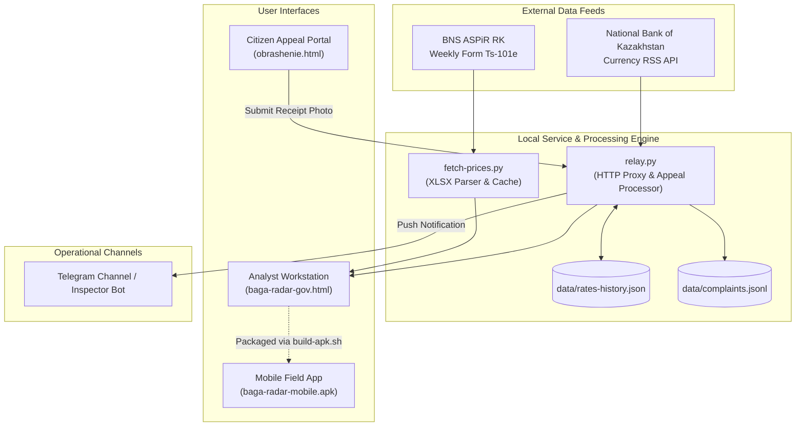

# Baga Radar (Баға Радар): Food Price Intelligence & Monitoring System

> Regional price monitoring, anomaly detection, and citizen appeal intake platform for socially significant food staples (СЗПТ) in Kazakhstan, developed for Hackathon Korkyt (Case 03).

[](https://python.org/)
[](https://stat.gov.kz/)
[](https://stat.gov.kz/)
[](https://nationalbank.kz/)
[](https://core.telegram.org/bots)
[](LICENSE)

---

## Executive Summary

Monitoring retail price dynamics across staple groceries is critical for regional food security, inflation mitigation, and consumer protection. **Baga Radar** automates this pipeline by combining official governmental statistical data, real-time foreign currency fluctuations, field-level retail telemetry, and crowd-sourced citizen price verification into a unified analyst workstation and citizen reporting channel.

### Core Modules & Capabilities

- **Unified Analyst Workstation (`baga-radar-gov.html`)**:
  - Single-file zero-dependency interface featuring interactive price matrices across 20 regions and 31 staple product categories.
  - Retail point alert queues flagging price spikes and threshold deviations.
  - Decision ledger and automated reporting summary exports.
- **Automated Statistical Ingestion (`fetch-prices.py`)**:
  - Direct integration with Bureau of National Statistics (BNS ASPiR RK) weekly publications (form Ts-101e).
  - Automated spreadsheet parsing and historical trend caching.
- **Local Relay & Telemetry Engine (`relay.py`)**:
  - Embedded HTTP proxy overcoming browser CORS restrictions to stream official National Bank of Kazakhstan exchange rates with 38-day historical tracking.
  - Ingestion endpoint for citizen appeals and price dispute claims.
- **Citizen Appeal & Photo Verification (`obrashenie.html`)**:
  - Mobile-responsive web form enabling residents to submit store coordinates, price tags, and photo receipts.
  - Automated dispatch of validated appeals directly to designated Telegram channels or inspectors.
- **Mobile Client (`baga-radar-mobile.apk` & `build-apk.sh`)**:
  - Lightweight standalone APK packaging the monitoring interface for on-site field inspectors.

---

## System Architecture



---

## Component Matrix

| Component | Technology | Description |
| :--- | :--- | :--- |
| `baga-radar-gov.html` | Vanilla HTML5 / ES6 / CSS3 | Analyst dashboard and pricing surveillance console |
| `obrashenie.html` | Vanilla HTML5 / Canvas | Resident appeal submission form with image capture |
| `relay.py` | Python 3 standard library | Multi-threaded HTTP daemon, NBRK currency relay & Telegram dispatcher |
| `fetch-prices.py` | Python 3 | Parser for BNS spreadsheet releases with regional mapping |
| `prices-real.json` | JSON Dataset | Normalized regional prices and index trends |
| `build-apk.sh` | Shell / Zip / Jarsigner | Automated APK bundling utility for field operations |

---

## Quickstart & Local Execution

### 1. Requirements

- Python 3.9 or higher
- Modern web browser

### 2. Starting the Relay Service

```bash
# Clone the repository
git clone https://github.com/NURJAKS/Hackathon_Korkyt222.git
cd Hackathon_Korkyt222

# Launch relay server
python3 relay.py
```

Access the interfaces:
- **Analyst Workstation**: `http://localhost:8787/`
- **Citizen Appeal Form**: `http://localhost:8787/obrashenie.html`

### 3. Fetching Latest Government Statistics

```bash
# Download latest publication and inject directly into the dashboard
python3 fetch-prices.py --inject baga-radar-gov.html
```

---

## Telegram Bot Integration

To receive citizen price appeals with photo receipts:

1. Create a configuration file from the template:
   ```bash
   cp .env.example .env
   ```
2. Populate the bot token obtained from `@BotFather`:
   ```ini
   TG_TOKEN=123456:ABC-DEF...
   TG_CHAT_ID=-1001234567890
   ```
3. To automatically detect your channel or user `TG_CHAT_ID`:
   ```bash
   python3 relay.py --chat-id --wait
   ```

---

## Building the Mobile Package

For field inspectors requiring an offline-first Android application:

```bash
./build-apk.sh
```

The script packages `baga-radar-gov.html` into a signed debug Android application ready for installation (`baga-radar-mobile.apk`).

---

## License

This project is licensed under the [MIT License](LICENSE).
